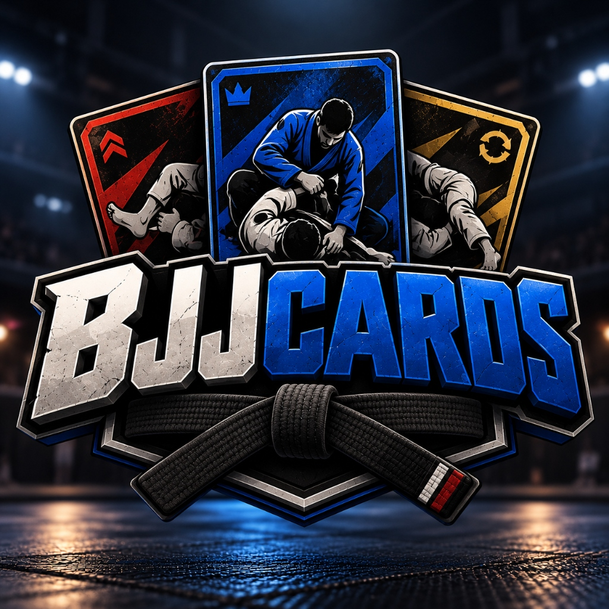

# BJJCARDS 🥋🃏
> **Tactical BJJ Card Battle & Career** — O Jogo Definitivo de Estratégia de Cartas e Carreira da Arte Suave.



## 📌 Sobre o Jogo
**BJJCARDS** é um jogo tático de combate de Jiu-Jitsu brasileiro baseado em cartas e posições reais do tatame. Com regras oficiais de pontuação da IBJJF, sistema de iniciativa autônoma do adversário e modo carreira completo com graduação por divisas até a Faixa Preta.

### ⚔️ Principais Mecânicas
- **Duelos Táticos Posicionais**: Cartas exclusivas para Luta em Pé, Guarda Fechada, Meia-Guarda, Passagem, 100kg, Montada e Costas.
- **Regras Oficiais IBJJF**: Pontuações exatas (+2 queda/raspagem, +3 passagem, +4 montada/costas), vantagens, punições acumulativas e desclassificação (DQ) por amarração/anti-jogo.
- **Iniciativa Autônoma & Anti-Amarração**: Adversários tomam decisões ativas e pressionam com base em intenção tática se o jogador hesitar no tempo de turno.
- **Criação de Atleta Personalizada**: Escolha entre 7 avatares realistas em alta definição ou envie sua própria foto oficial de atleta.
- **Modo Carreira Profissional**:
  - Circuito amador da **CBJJA** para Faixas Brancas.
  - Circuito profissional da **CBJJP** (Opens, Brasileiro, Europeu e Mundial).
  - Sistema de treino com gasto de energia, assimilação de skills em semanas e graduação com 4 divisas por faixa.

---

## 🚀 Como Executar o Projeto

### Pré-requisitos
- Node.js (v18+)
- npm ou yarn

### Instalação
```bash
# Instalar dependências
npm install

# Iniciar servidor de desenvolvimento
npm run dev

# Executar suíte de testes (Vitest)
npm run test

# Gerar build de produção
npm run build
```

---

## 🛠️ Tecnologias
- **React 18** + **TypeScript**
- **Vite**
- **Tailwind CSS**
- **Lucide Icons**
- **Web Audio API** (efeitos sonoros táteis de tatame, gongo e apito)
- **Vitest**

---

© 2026 **BJJCARDS**. Todos os direitos reservados.
Regras Oficiais de Pontuação da Federação Internacional de Jiu-Jitsu (IBJJF).
